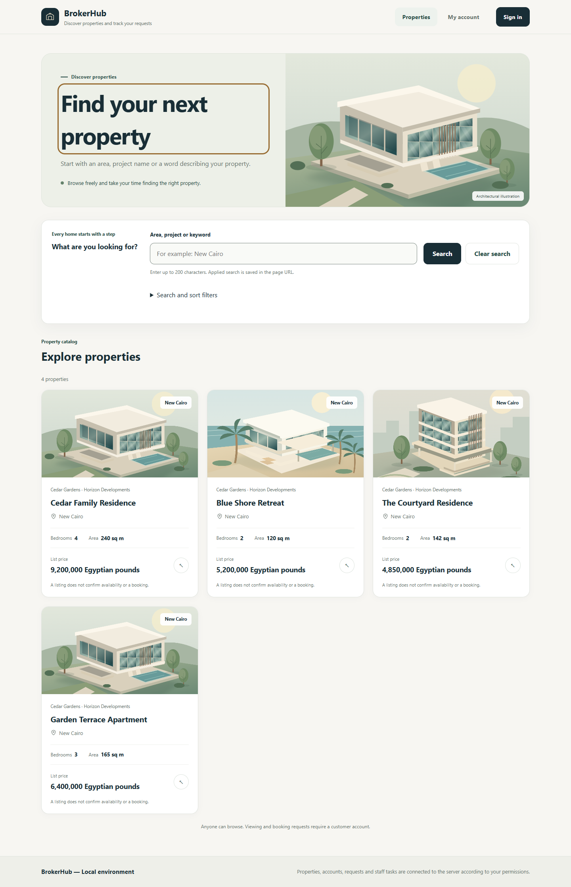
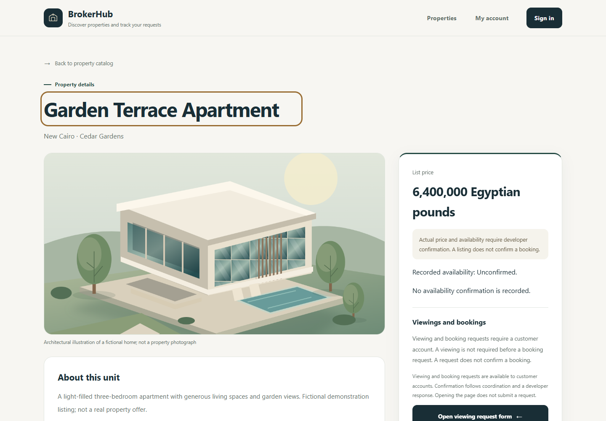
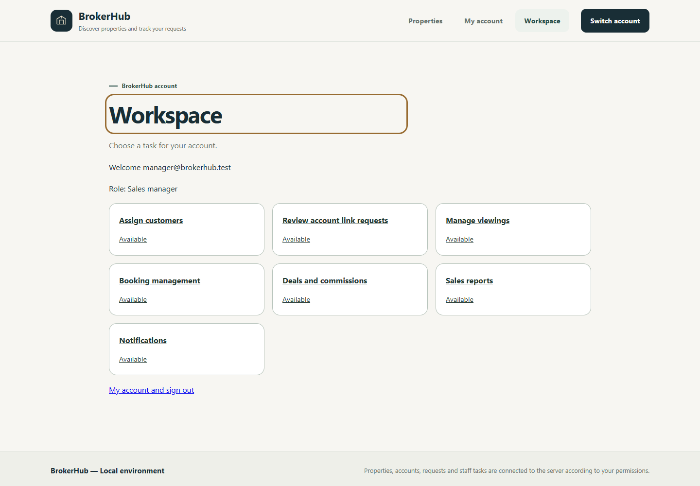
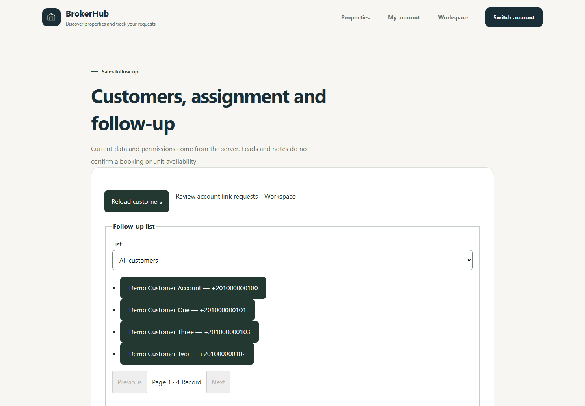
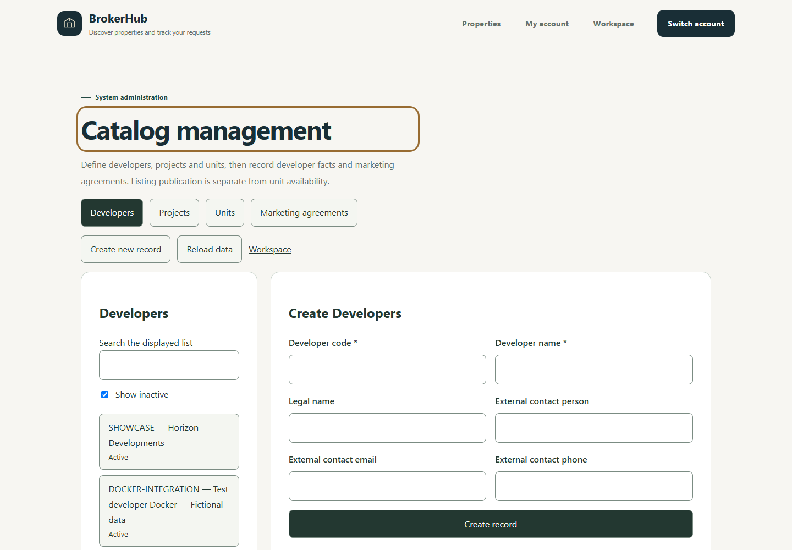
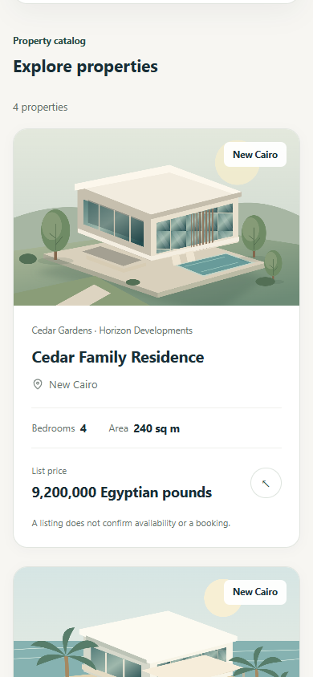

# BrokerHub

A full-stack real estate brokerage application for managing property listings, customers, viewings, bookings, sales and commissions.

Built with **Angular 22**, **ASP.NET Core 10**, **SQL Server**, **RabbitMQ** and **Docker Compose**. The interface and repository content are in English.

## Screenshots

### Property catalog



### Property details



### Sales workspace



### Customer management



### Catalog administration



### Mobile experience



Screenshots show the running application with fictional demonstration data. They do not represent real listings or financial transactions.

## Features

- Public property search, filters, listing details and images.
- Customer registration, email confirmation, password recovery and server-managed account sessions.
- Separate customer, sales employee, sales manager and system administrator permissions.
- Customer profiles, manual assignment, responsibility transfers, requirements, notes and lead history.
- Viewing requests, external coordination, alternative appointments, customer acceptance and outcomes.
- Booking requests, developer responses, extensions, cancellations and external deposit/refund records.
- Recorded external sales, historical commission snapshots, collections and reports separated by currency.
- Durable notifications, transactional outbox processing and RabbitMQ messaging over TLS.

The application records payments made outside the system; it does not process payments. A published listing or submitted request does not guarantee availability or a confirmed booking.

## Run locally

Prerequisites: Docker Desktop with Linux containers and PowerShell 7.4 or later. Docker builds the API and frontend, so local .NET and Node.js installations are optional for this path.

```powershell
git clone https://github.com/mohamedfathy5242420-cloud/Real-Estate.git
cd Real-Estate
pwsh -NoProfile -File scripts/Start-FullStack.ps1
```

Open the [property catalog](http://localhost:8080/catalog), [sign-in page](http://localhost:8080/auth/login) or [Swagger UI](http://localhost:8080/swagger).

The startup script generates a private `.env`, local messaging certificates and an initial administrator account. Find `ADMIN_EMAIL` and `ADMIN_PASSWORD` in your local `.env`. Do not commit that file. After the first administrator sign-in, set `BOOTSTRAP_ADMIN=false` and restart the services.

A new database starts with an administrator, not preloaded customers or listings. Use the administrator workspace to create staff accounts, employee profiles, developers, projects, units and marketing agreements. Activate the agreement and publish eligible listings. Record actual developer price and availability confirmations separately.

Local development captures email links privately instead of sending real email. For an allowlisted local address:

```powershell
pwsh -NoProfile -File scripts/Get-LocalIdentityLink.ps1 -Recipient customer@brokerhub.test
```

Register that address first, then open its confirmation link locally. Treat confirmation and password-reset links as private credentials.

Stop services while retaining database and application data:

```powershell
docker compose down
```

Restart without rebuilding:

```powershell
pwsh -NoProfile -File scripts/Start-FullStack.ps1 -NoBuild
```

## Services

| Service | Responsibility |
| --- | --- |
| `gateway` | Nginx entry point on `127.0.0.1:8080` |
| `frontend` | Angular application with server rendering for public pages |
| `api` | ASP.NET Core API, account sessions and business workflows |
| `sql` | SQL Server persistence |
| `rabbitmq` | Durable messaging over TLS |
| `migrate` | One-shot database migration runner |

SQL Server, RabbitMQ, the API and the frontend are reached through the internal Docker network. Named volumes persist the database, images, Data Protection keys, local identity links and messaging data. `/readyz` checks application readiness.

The Compose configuration is for local development. Browser traffic uses local HTTP; messaging uses TLS. Production hosting, external email delivery and real payment processing are outside this configuration.

## Source layout

```text
src/                    .NET API, application, domain and infrastructure layers
frontend/               Angular application and unit tests
tests/                  .NET test projects
docker/                 Container images, gateway and messaging configuration
integration/            Browser checks and messaging probe source
scripts/                Local startup, identity-link and verification tools
assets/screenshots/     Frontend screenshots used in this README
compose.yaml            Local service composition
BrokerHub.sln           .NET solution
```

## Development and verification

For frontend development, use Node.js 24 and the pinned pnpm version in `frontend/package.json`:

```powershell
cd frontend
pnpm install --frozen-lockfile
pnpm test --watch=false
pnpm build
```

Backend development uses the .NET SDK pinned in `global.json`:

```powershell
dotnet build BrokerHub.sln
```

To run the container-based frontend checks and HTTP integration smoke test against a local instance:

```powershell
pwsh -NoProfile -File scripts/Test-Local.ps1
```

The smoke test creates fictional records in the local database. Use a development database. Workflow plans, generated reports, dependencies, build outputs, credentials and local database files are excluded from this repository.
